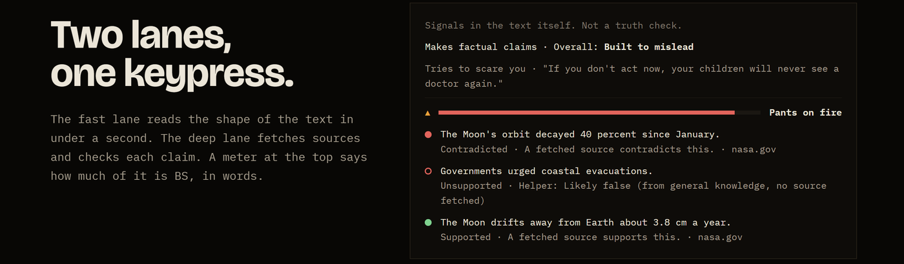
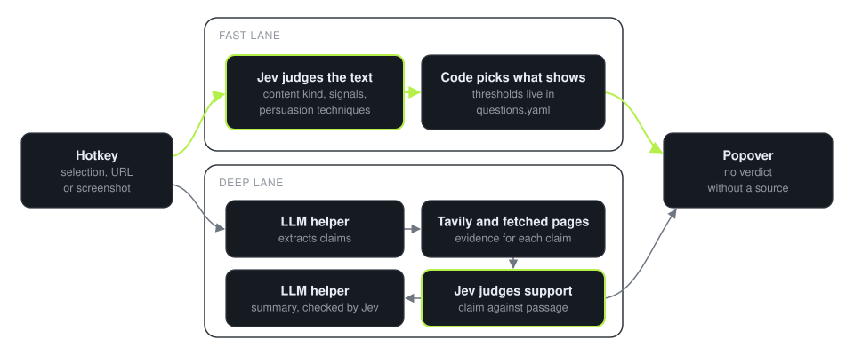

<h1 align="center">Callout</h1>

<p align="center">
  A Windows tray app that checks what you are reading.
</p>

<p align="center">
  <a href="https://github.com/The-Little-AI-Company/callout/releases/tag/v0.2.0"><strong>Download for Windows</strong></a> &nbsp;·&nbsp;
  <a href="https://the-little-ai-company.github.io/callout/">Website</a> &nbsp;·&nbsp;
  <a href="https://the-little-ai-company.github.io/callout/docs/how-it-works.html">How it works</a>
</p>

<p align="center">
  
</p>

<p align="center"><sub>The Callout website. The result on the right is a sample drawn in HTML on the site. It is not a capture of the app.</sub></p>

Press a hotkey over anything you are reading. A small popover shows whether the
text is trying to manipulate you. It then shows whether the specific claims hold
up against sources it fetched. Unsure is a real answer. The
header on each result reads **Signals in the text itself. Not a truth check.**

## Download

| Platform | Download | Requires |
| --- | --- | --- |
| Windows 10 and 11 | [Callout-Setup.exe](https://github.com/The-Little-AI-Company/callout/releases/download/v0.2.0/Callout-Setup.exe) or [Callout.msi](https://github.com/The-Little-AI-Company/callout/releases/download/v0.2.0/Callout.msi) | A TypeSafe API key |

Version 0.2.0, published 2026-09-17. The build is unsigned, so SmartScreen warns.
Select **More info**, then **Run anyway**. The installer is 2.8 MB.
<!-- source: gh api repos/The-Little-AI-Company/callout/releases, asset size 2751405 bytes -->

There is no macOS or Linux build.

## What you can do

- Highlight text anywhere and press **Ctrl+Shift+Space**. You can change the key in Settings.
- Copy a URL and press the key, or click the tray icon.
- Read the fast lane: signals in the text and up to four persuasion techniques, each with the sentence that shows it.
- Read the deep lane: each claim with a traffic light, a one-line reason, and the passage and link behind it.
- Read a meter, computed in code from the verdicts. It shows words, never a percentage.

## The honesty rules

- **No verdict without a source.** Green needs a supporting source and no contradiction. Red needs a contradicting source or a fabricated quote.
- **Helper calls are labeled.** When sources are silent, the helper gives a call from general knowledge. It shows as a hollow dot with the words "no source fetched". It never overrides a sourced verdict.
- **Unsure names its reason.** A gray row says which reason: no source found, source paywalled, evidence off-topic, or judgment not confident.
- **The jokes stay out of verdicts.** The app can be funny while it loads. It cannot be funny in place of being unsure.

## How it works

<picture>
  <source media="(prefers-color-scheme: dark)" srcset="assets/callout-engine-dark.svg">
  <source media="(prefers-color-scheme: light)" srcset="assets/callout-engine-light.svg">
  
</picture>

- **Jev decides.** TypeSafe's Jev model returns probabilities, never prose. It judges content kind, manipulation, passage relevance, claim support and each sentence the helper writes.
- **Code owns the flow.** Thresholds and question wording live in [`content/questions.yaml`](content/questions.yaml).
- **The LLM helper only assists.** It extracts claims, writes search queries, reads screenshots and drafts the summary. It never judges. DeepSeek is the default, and any OpenAI-compatible or Anthropic endpoint works.
- **The shell is small.** The app uses Tauri 2 and Rust for the tray, hotkey, clipboard capture and credential store. The [decision log](docs/DECISIONS.md) records why.

| Path | What it holds |
| --- | --- |
| `engine/` | Fast lane, deep lane, Jev client and helper adapter, in TypeScript with no Tauri or DOM dependency |
| `content/` | Questions, labels, thresholds, helper prompts and the joke bank |
| `src/` | Popover, settings and screenshot overlay |
| `src-tauri/` | The Rust shell |
| `test/` | Unit tests, a 20-sample evaluation set and its runner |

## Requirements

Callout uses your own keys. Open Settings, paste each key, then press **Test and save**.

| Key | Needed for | Required |
| --- | --- | --- |
| TypeSafe | Each judgment. The fast lane works with this key alone. | Yes |
| Tavily | Web evidence for the deep lane | Recommended |
| LLM helper | Claim extraction, screenshots and the summary | Recommended |

The [setup guide](docs/SETUP.md) has the steps.

## Privacy

Callout has no server, no account and no telemetry. Text you check goes to the
APIs you configure and to the pages Callout fetches for evidence. Keys are in
Windows Credential Manager. History is off by default. Usage counters stay on your
machine.

## Status

Released as 0.2.0 on GitHub. The release notes call it an unsigned beta build.

| In 0.2.0 | Not yet |
| --- | --- |
| Fast lane and deep lane | Code signing |
| Tray app, hotkey, settings and screenshot capture | macOS |
| MSI and NSIS installers built by CI | Final mascot art. The build ships a placeholder. |
| Engine tests in CI, then a Windows build | Published evaluation numbers. The [cost table](docs/COSTS.md) is pending. |

TypeSafe's Jev is in beta. Callout depends on it for every judgment, and its
pricing is unpublished ([cost notes](docs/COSTS.md)).

## Build from source

```sh
pnpm install
pnpm test
pnpm typecheck
```

<!-- tested: 2026-11-06, clean clone on Ubuntu, Node 24.22.1, pnpm 10.33.2 -->

`pnpm test` needs no keys. To run the app:

```sh
pnpm tauri dev
```

Untested on a clean machine. It needs Rust and, on Windows, the WebView2 runtime.
CI runs the test and Windows build jobs in
[`build.yml`](.github/workflows/build.yml).

## Contributing

See [CONTRIBUTING.md](CONTRIBUTING.md). Most improvements are edits to the three
files under `content/`. No TypeScript is required.

## License

MIT, with a plain-language note on attribution. See [LICENSE](LICENSE).
